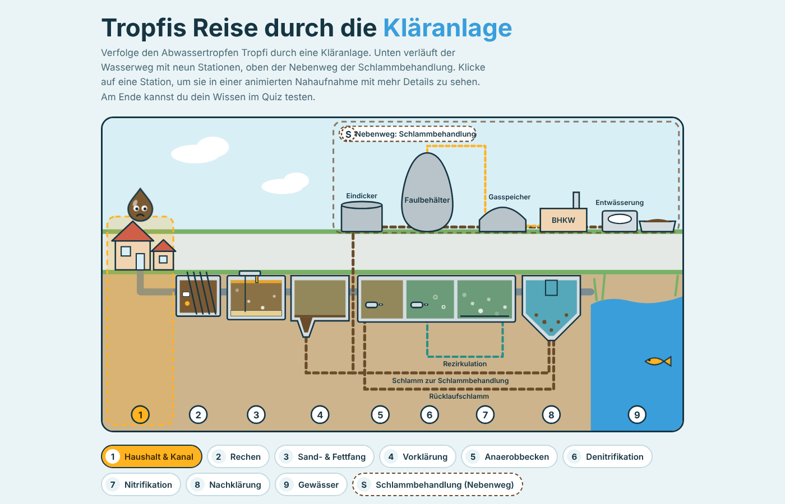
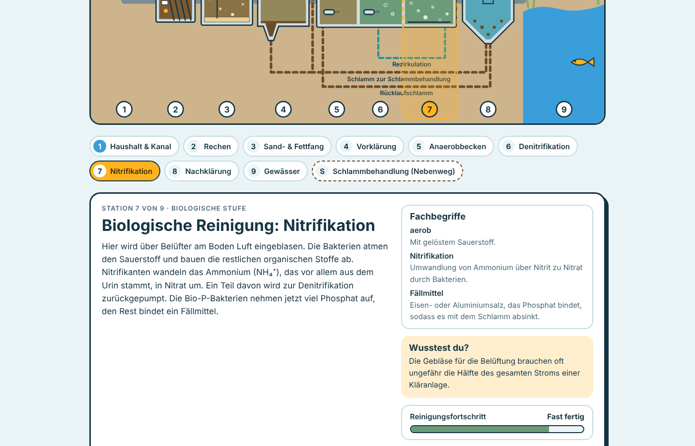
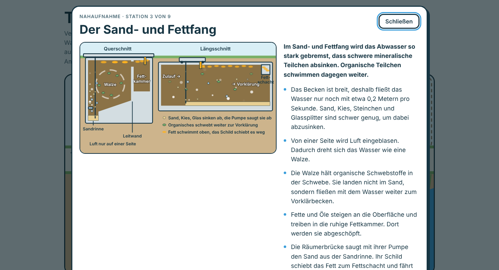
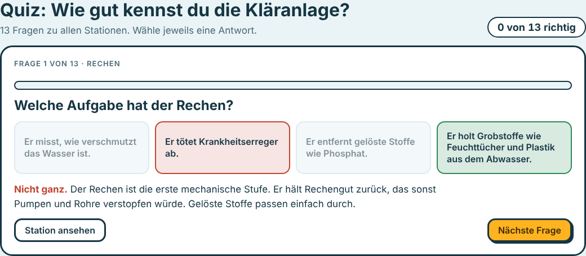
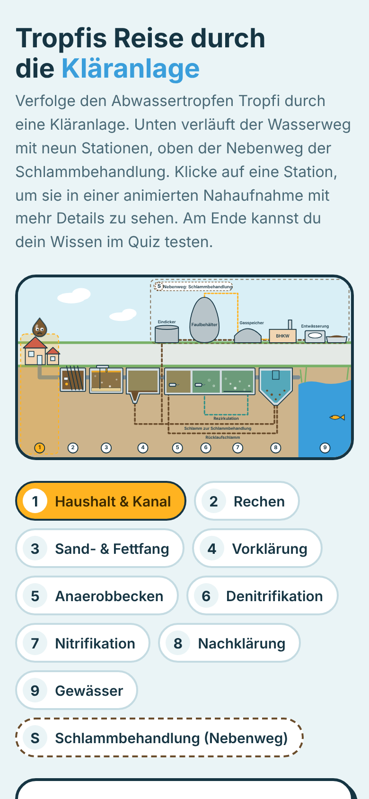

# Tropfis Reise durch die Kläranlage

Eine interaktive Kläranlage für Kinder ab etwa 10 Jahren (Klasse 5 bis 8). Der Wassertropfen Tropfi reist durch die Reinigungsstufen einer kommunalen Kläranlage. Zu jeder Station gibt es eine animierte Nahaufnahme mit Extra-Infos.

## Stationen

**Wasserweg**

1. Zuhause und Kanal
2. Rechen
3. Belüfteter Sand- und Fettfang (mineralische Stoffe sinken ab, Organisches schwebt weiter)
4. Vorklärbecken
5. Anaerobbecken (Bio-P)
6. Denitrifikation (anoxisch, vorgeschaltet)
7. Nitrifikation (belüftet)
8. Nachklärbecken
9. Ablauf in den Fluss

**Nebenweg: Schlammbehandlung**

Eindicker, Faulbehälter, Gasspeicher, BHKW und Entwässerung

Jede Station erklärt die wichtigsten Fachbegriffe. Am Ende gibt es ein Wissensquiz mit 13 Fragen zu allen Stationen.

## Screenshots

<table>
<tr><td width="50%"> Station 7: Nitrifikation mit Fachbegriffen</td><td width="50%"> Nahaufnahme: Sand- und Fettfang</td></tr>
<tr><td width="50%"> Wissensquiz</td><td width="50%"> Auf dem Handy</td></tr>
</table>

## Benutzung

Öffne `index.html` im Browser. Es ist kein Build nötig und es gibt keine Abhängigkeiten. Nur die Schriften kommen von Google Fonts, ohne Internet greift eine Standardschrift.

Bedienung:

- Tippe auf eine Station im Bild, um ihre Nahaufnahme zu öffnen.
- Mit „Weiter“, „Zurück“ oder den Pfeiltasten gehst du durch die Stationen.
- Esc schließt die Nahaufnahme.

## Hinweis

Die Zahlen sind vereinfachte Richtwerte und gelten nicht für eine bestimmte Anlage.
